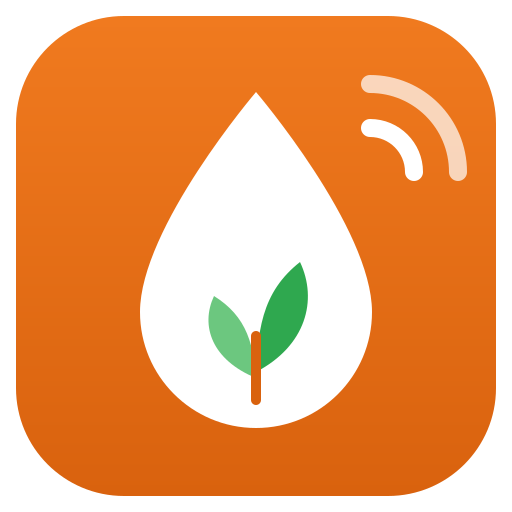

# ioBroker.gardena-smart

[](https://www.npmjs.com/package/iobroker.gardena-smart)
[](https://www.npmjs.com/package/iobroker.gardena-smart)


[](https://nodei.co/npm/iobroker.gardena-smart/)

**Tests:** 

🇩🇪 [Deutsche Anleitung](docs/de/README.md)

## GARDENA smart system adapter for ioBroker

Control and monitor your GARDENA smart system devices – **directly in your home network**, without the GARDENA cloud.
The adapter talks to your GARDENA smart Gateway. Changes (e.g. a valve opens) arrive immediately, there is no polling and no request limit.

The GARDENA app keeps working as before.

> ⚠️ **Early version.** Tested with Water Control and smart Sensor (1st generation). The other devices are implemented according to the
> documentation of GARDENA but not yet tested on real hardware – feedback is very welcome!

## Setup in 3 steps

1. **Switch on the local API of the gateway**
   Open the web page of your gateway in the browser (type its IP address, you find it in your router), log in with the gateway password,
   open **"Advanced settings"** and switch on **"Local API"**. (Needs a current gateway firmware – update it in the GARDENA app if the switch is missing.)
2. **Install the adapter** and open the settings of the instance.
3. **Enter the address and the password** of the gateway and save. That's it – your devices appear under `gardena-smart.0.devices`.

On the first connection the adapter remembers the security certificate of your gateway. It will only talk to exactly this gateway afterwards,
so your password can't end up somewhere else. If you reset or replace your gateway, press the button `info.trustNewCertificate` once.

## Supported devices

| Device | What you can do | Tested |
| --- | --- | --- |
| smart Water Control | open/close the valve, watering time, end of the watering, button time, schedules, battery, temperature | ✅ 1st gen. · ❔ 2nd gen. |
| smart Sensor / Sensor II | soil moisture, soil temperature, light and air temperature (Sensor I), measure now | ✅ Sensor II |
| smart Irrigation Control | open/close each valve, close all valves | ❔ |
| smart Power Adapter | switch on (for a time) / off | ❔ |
| smart SILENO mowers | status, start for a time, park until the next schedule / until further notice, pause (2nd gen.) | ❔ |
| smart Pressure Pump | on/off, pressure, flow, temperature, operating mode | ❔ |

✅ tested on real hardware · ❔ implemented, not yet tested – please report how it works for you.

Devices the adapter does not know yet are shown with their general information. With the expert option **"Show raw values"** you see
everything the gateway reports – please attach these values when you open an issue for a new device.

## How to use

Each device appears as `gardena-smart.0.devices.<device id>`. You can rename it in ioBroker – or let the adapter take over the names from
the GARDENA app (see below).

| Data point | Meaning |
| --- | --- |
| `info.online` | Device is reachable |
| `info.battery` / `info.signal` | Battery level / radio signal in % |
| `info.frostWarning` | `true` if it is close to freezing – better don't water |
| `info.identify` | Press to let the LED of the device flash |
| `valve1.open` | `true` = open valve, `false` = close valve. Shows the current state |
| `valve1.duration` | How long the valve stays open when you set `open` to `true` (minutes) |
| `valve1.active` / `valve1.source` | Watering is running / who started it: `manual` (adapter, app or button), `schedule` or `off` |
| `valve1.endTime` | When the watering ends (time stamp, 0 = not watering) – handy for "7 min left" |
| `valve1.buttonTime` | Watering time when someone presses the button on the device (minutes) |
| `valve1.schedules` | Schedules stored in the device (start, end, minutes, weekdays) as JSON – see note below |
| `valve1.schedulePaused` / `valve1.pausedUntil` | Schedules are paused / until when |
| `sensor.soilMoisture` / `sensor.soilTemperature` | Soil moisture in % / soil temperature in °C |
| `sensor.measure` | Press to measure now |
| `power.on`, `pump.on`, `mower.start` … | Switch or start the device for the time in the matching `duration` |

**Schedules:** please create, change or pause schedules in the GARDENA app. The app does not notice changes made directly on the device.
With "GARDENA assisted mode" the cloud shifts start times and durations – `valve1.schedules` shows the times at which the device really waters.

### Example: water the lawn for 10 minutes (JavaScript adapter)

```javascript
const valve = 'gardena-smart.0.devices.<device id>.valve1';
setState(`${valve}.duration`, 10);
setState(`${valve}.open`, true); // closes automatically after 10 minutes
```

## Optional: device names from the GARDENA app

The local connection does not know the names you gave your devices in the GARDENA app. If you want them in ioBroker, enter your own App Key:

1. Sign in to the [Husqvarna Developer Portal](https://developer.husqvarnagroup.cloud/) with your GARDENA account.
2. Create a new application and connect **Authentication API** and **GARDENA smart system API**.
3. Copy **Application Key** and **Application Secret** into the adapter settings (section *GARDENA cloud*).

The adapter reads the names about once a day (2 requests). GARDENA allows 1000 requests per week per key – the adapter counts
its requests in `cloud.quota.*` and slows down by itself long before the limit. Names you changed yourself in ioBroker are kept.

## Questions and problems

Please open an issue on [GitHub](https://github.com/Schimi1983/ioBroker.gardena-smart/issues). Set the log level of the instance to `debug` and add the log.

## Support

The adapter is free and stays free. If it is useful to you and you want to say thanks, you can support the development:

[](https://github.com/sponsors/Schimi1983)
[](https://paypal.me/Schimi1983)

Bug reports and ideas in the [issues](https://github.com/Schimi1983/ioBroker.gardena-smart/issues) help just as much.

## Technical background

- Connection: secure WebSocket to the gateway on port 8443 (local API, provided by GARDENA)
- The protocol was implemented based on the official documentation and library of GARDENA:
  [gardena-smart-local-api](https://github.com/cloudless-garden/gardena-smart-local-api) (no code taken over)
- Cloud (optional): GARDENA smart system API v2, only for the device names; request counter over 7 days, 10 % reserve for
  requests you trigger yourself, pause after "too many requests" (1 h, then longer, at most 24 h)

## Changelog

<!--
	Placeholder for the next version (at the beginning of the line):
	### **WORK IN PROGRESS**
-->

### **WORK IN PROGRESS**

- (Schimi1983) Initial release: local connection to the GARDENA smart Gateway (Water Control, Irrigation Control, Sensor, Power Adapter, SILENO mowers, Pressure Pump)
- (Schimi1983) Water Control: end of the current watering, schedules and schedule pause (read only)
- (Schimi1983) Optional: device names from the GARDENA app via your own App Key, with request counter for the weekly limit

## License

MIT License

Copyright (c) 2026 Schimi <github@world-mg.de>

Permission is hereby granted, free of charge, to any person obtaining a copy
of this software and associated documentation files (the "Software"), to deal
in the Software without restriction, including without limitation the rights
to use, copy, modify, merge, publish, distribute, sublicense, and/or sell
copies of the Software, and to permit persons to whom the Software is
furnished to do so, subject to the following conditions:

The above copyright notice and this permission notice shall be included in all
copies or substantial portions of the Software.

THE SOFTWARE IS PROVIDED "AS IS", WITHOUT WARRANTY OF ANY KIND, EXPRESS OR
IMPLIED, INCLUDING BUT NOT LIMITED TO THE WARRANTIES OF MERCHANTABILITY,
FITNESS FOR A PARTICULAR PURPOSE AND NONINFRINGEMENT. IN NO EVENT SHALL THE
AUTHORS OR COPYRIGHT HOLDERS BE LIABLE FOR ANY CLAIM, DAMAGES OR OTHER
LIABILITY, WHETHER IN AN ACTION OF CONTRACT, TORT OR OTHERWISE, ARISING FROM,
OUT OF OR IN CONNECTION WITH THE SOFTWARE OR THE USE OR OTHER DEALINGS IN THE
SOFTWARE.

GARDENA is a registered trademark of GARDENA GmbH. This project is not affiliated with GARDENA or Husqvarna Group.
